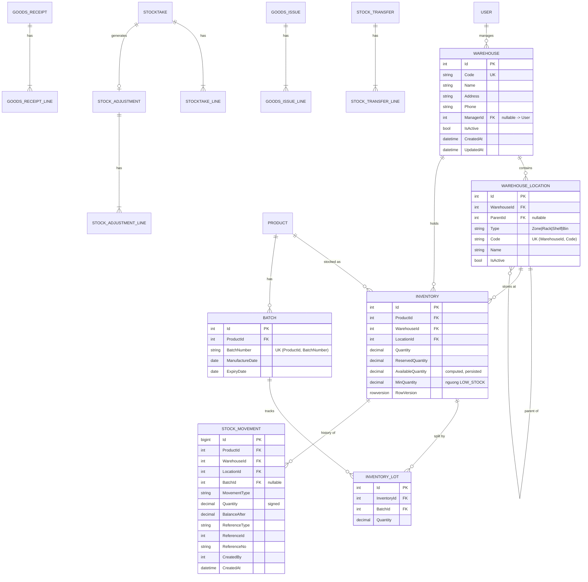
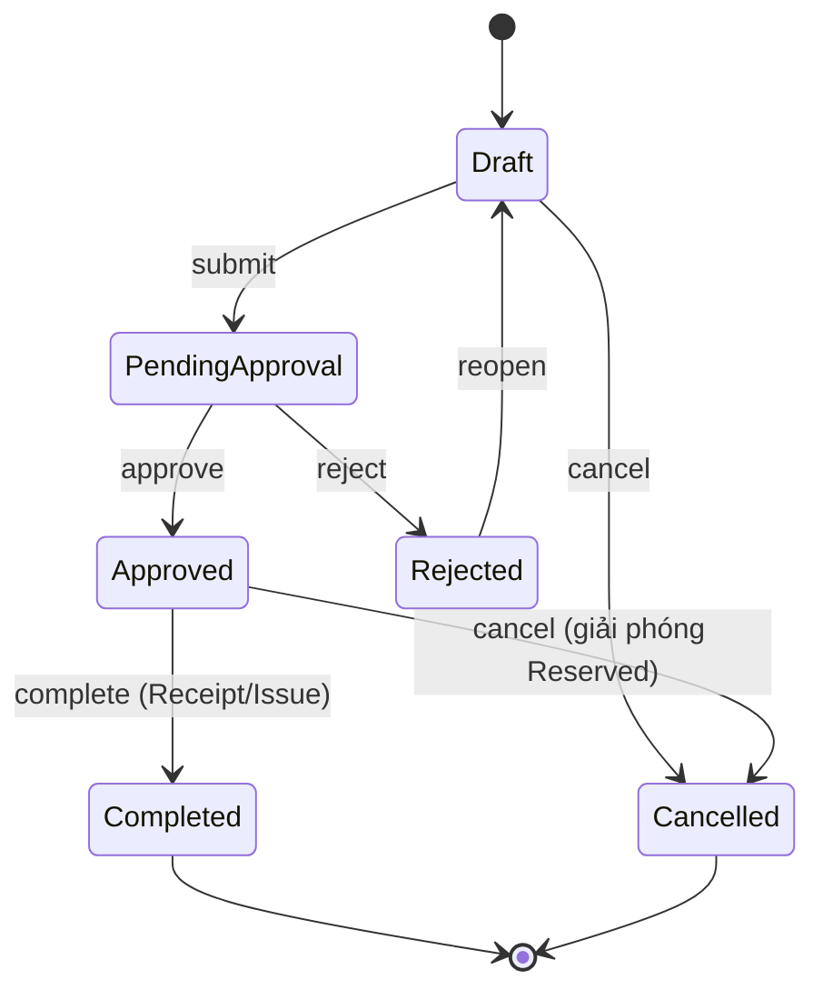
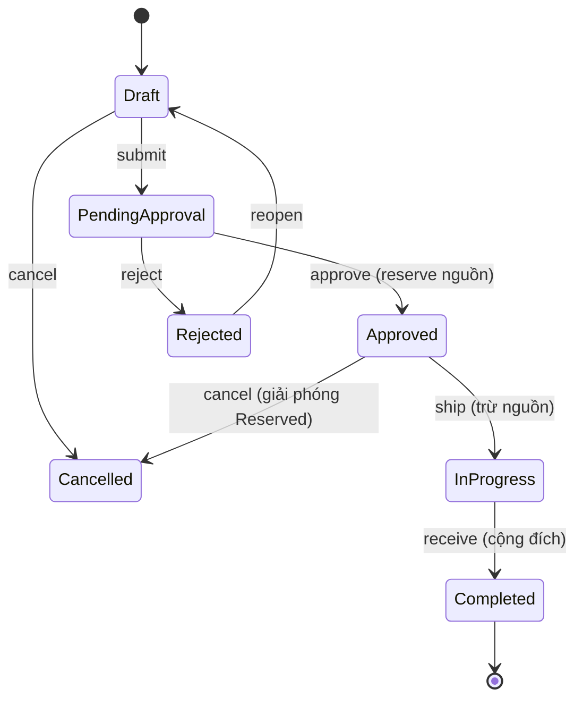
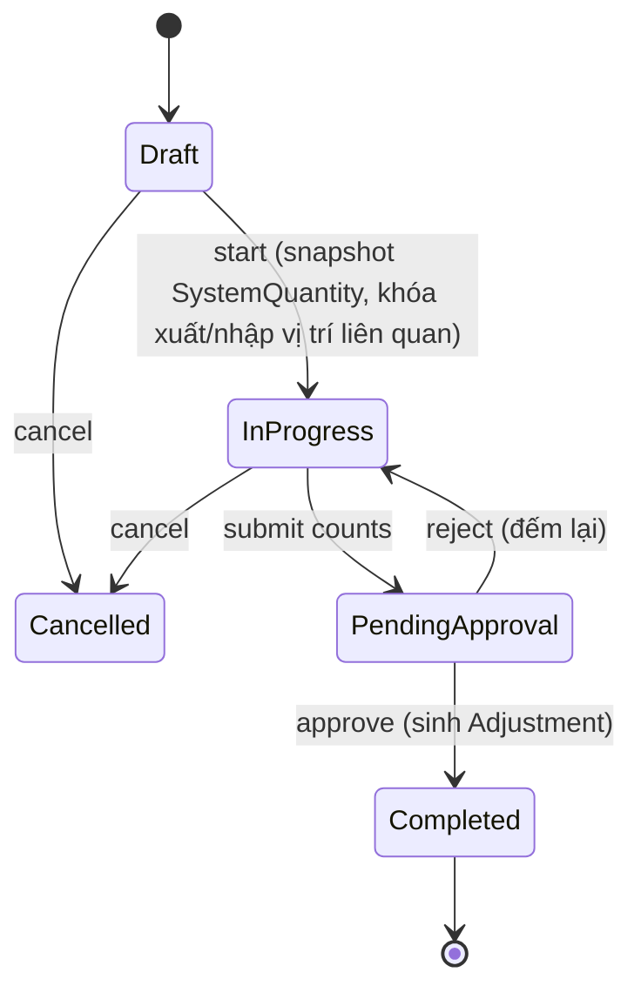

# Warehouse Module Spec (W-01)

> Owner: Người 2 (module Kho). Phối hợp: Người 1 (Product), Người 3 (User/Permission, Common Query, security).
> Trạng thái: **Draft để nhóm review**. Mọi thay đổi quy tắc nghiệp vụ phải cập nhật lại file này trước khi sửa code.

## 1. Phạm vi

| Nhóm | Thành phần | Ghi chú |
|---|---|---|
| Danh mục | Warehouse, WarehouseLocation (Zone > Rack > Shelf > Bin) | CRUD, deactivate, không hard delete khi còn phụ thuộc |
| Tồn kho | Inventory, InventoryLot (Batch/Expiry) | Tồn theo Product + Warehouse + Location |
| Lịch sử | StockMovement | Bất biến (append-only), mọi thay đổi tồn kho đều sinh movement |
| Chứng từ | GoodsReceipt, GoodsIssue, StockTransfer, Stocktake, StockAdjustment | Có luồng duyệt và trạng thái thống nhất |
| Lô hàng | Batch (BatchNumber, ManufactureDate, ExpiryDate) | Cảnh báo NEAR_EXPIRY / EXPIRED |
| Tích hợp | Outbox event → n8n webhook | LOW_STOCK, OUT_OF_STOCK, NEAR_EXPIRY, EXPIRED, PENDING_APPROVAL |

Ngoài phạm vi: giá vốn/kế toán kho, đơn mua/đơn bán (chỉ tham chiếu qua `ReferenceType/ReferenceNo`).

## 2. Quy ước kỹ thuật

- Khóa chính `int` identity (đồng bộ với `Product`).
- Mã nghiệp vụ (`Code`, `DocumentNo`) lưu **UPPERCASE**, trim, tối đa 20–30 ký tự, chỉ gồm `A-Z 0-9 - _ .`.
- Số lượng: `decimal(18,3)` (hỗ trợ đơn vị kg, lít…). Mọi số lượng trên dòng chứng từ phải `> 0`.
- Thời gian: `DateTime` UTC (`CreatedAt`, `UpdatedAt`, `ApprovedAt`…).
- Người thao tác: `CreatedBy`, `ApprovedBy`… là `int?` UserId lấy từ claim `sub`/`NameIdentifier`. FK sang bảng User sẽ thêm khi module User (Người 3) được merge.
- Concurrency: bảng `Inventory` và các header chứng từ có `RowVersion` (`rowversion`).
- Không hard delete: Warehouse, Location, Batch dùng `IsActive = false`. Chứng từ chỉ được xóa khi ở `Draft`. `StockMovement` **không bao giờ** sửa/xóa.
- Tầng code: `Models` → `Data/Configurations` → `Dtos` (+ `Validators`) → `Repositories` → `Services` → `Controllers`.

## 3. ERD



Các dòng chứng từ (`*_LINE`) đều có: `ProductId`, `LocationId`, `BatchId?`, `Quantity`, `Note`. Riêng:
- `GOODS_RECEIPT_LINE`: `BatchNumber?`, `ExpiryDate?` (tạo Batch khi hoàn tất nếu chưa có).
- `STOCK_TRANSFER_LINE`: `FromLocationId`, `ToLocationId`.
- `STOCKTAKE_LINE`: `SystemQuantity` (snapshot), `CountedQuantity?`, `Difference` (computed).
- `STOCK_ADJUSTMENT_LINE`: `QuantityChange` (có dấu, ≠ 0), `Reason`.

## 4. Quy tắc tồn kho

### 4.1 Định nghĩa

| Trường | Ý nghĩa |
|---|---|
| `Quantity` | Tồn thực tế đang nằm tại vị trí |
| `ReservedQuantity` | Đã giữ chỗ cho phiếu xuất/chuyển đã duyệt nhưng chưa hoàn tất |
| `AvailableQuantity` | `Quantity - ReservedQuantity` — số lượng còn được phép giữ chỗ/xuất mới |

### 4.2 Bất biến (enforce ở cả DB và Service)

1. `Quantity >= 0`, `ReservedQuantity >= 0`, `ReservedQuantity <= Quantity` ⇒ `AvailableQuantity >= 0`.
2. `AvailableQuantity` là **computed column persisted** trong DB — không ghi trực tiếp từ code.
3. Unique `(ProductId, WarehouseId, LocationId)`; `Location.WarehouseId` phải bằng `Inventory.WarehouseId`.
4. Chỉ được đặt tồn kho ở Location loại **Bin** và đang `IsActive`.
5. Với sản phẩm theo lô: `SUM(InventoryLot.Quantity) = Inventory.Quantity`.
6. Tồn kho **chỉ thay đổi qua chứng từ** (Receipt/Issue/Transfer/Stocktake/Adjustment). Không có API sửa trực tiếp `Quantity`. Bulk thay đổi tồn kho phải đi qua Adjustment/Stocktake.
7. Mỗi thay đổi `Quantity` sinh đúng 1 `StockMovement` trong **cùng transaction**; thay đổi chỉ `ReservedQuantity` không sinh movement (được audit qua chứng từ).

### 4.3 Chống âm kho khi xuất cạnh tranh

Giữ chỗ/trừ kho dùng câu lệnh điều kiện nguyên tử, ví dụ:

```sql
UPDATE Inventory SET ReservedQuantity = ReservedQuantity + @qty
WHERE Id = @id AND Quantity - ReservedQuantity >= @qty;   -- 0 rows => không đủ tồn
```

Kết hợp check constraint của DB làm lớp bảo vệ cuối. Toàn bộ thao tác của một chứng từ chạy trong 1 transaction; lỗi bất kỳ dòng nào ⇒ rollback toàn bộ.

### 4.4 Ảnh hưởng tồn kho theo chứng từ

| Chứng từ | Khi Approve | Khi Complete | Khi Cancel (sau Approve) |
|---|---|---|---|
| Goods Receipt | — | `Quantity +=` (tạo Inventory nếu chưa có), movement `RECEIPT` | — |
| Goods Issue | `Reserved +=` (fail nếu Available thiếu) | `Quantity -=`, `Reserved -=`, movement `ISSUE` | `Reserved -=` |
| Stock Transfer | `Reserved +=` tại nguồn | Nguồn: `Quantity -=`, `Reserved -=` (`TRANSFER_OUT`); Đích: `Quantity +=` (`TRANSFER_IN`) | `Reserved -=` tại nguồn |
| Stock Adjustment | Áp dụng ngay: `Quantity += QuantityChange`, movement `ADJUSTMENT_IN/OUT` (fail nếu làm `Quantity < Reserved`) | — | — |
| Stocktake | Sinh Stock Adjustment (đã duyệt) cho các dòng có `Difference ≠ 0`, movement `STOCKTAKE` | — | — |

## 5. Trạng thái chứng từ (thống nhất)

Enum chung `DocumentStatus`: `Draft`, `PendingApproval`, `Approved`, `InProgress`, `Completed`, `Rejected`, `Cancelled`.

Quy tắc chung:
- Chỉ `Draft` được sửa/xóa dòng. `Rejected` quay về được `Draft` để sửa và gửi lại.
- `Completed`, `Cancelled` là trạng thái cuối — không chuyển tiếp.
- Người duyệt không được là người tạo chứng từ (four-eyes), trừ khi có quyền `*_APPROVE` **và** cấu hình cho phép tự duyệt (mặc định: không).

### 5.1 Goods Receipt / Goods Issue / Stock Adjustment



Với Stock Adjustment: `approve` áp dụng thay đổi và chuyển thẳng `Completed`.

### 5.2 Stock Transfer



Chuyển trong cùng kho (khác Bin) được phép `ship` + `receive` trong một bước `complete`.

### 5.3 Stocktake



Trong khi Stocktake `InProgress`, các chứng từ khác không được `complete`/`approve` trên cùng (Warehouse, Location) đang kiểm kê.

## 6. Phân quyền

Policy dạng permission claim (`permission`), tên do module Kho đề xuất, Người 3 đăng ký vào hệ thống Role/Permission:

| Nhóm | Permissions |
|---|---|
| Warehouse | `WAREHOUSE_VIEW`, `WAREHOUSE_CREATE`, `WAREHOUSE_UPDATE`, `WAREHOUSE_DELETE` |
| Location | `LOCATION_VIEW`, `LOCATION_CREATE`, `LOCATION_UPDATE`, `LOCATION_DELETE` |
| Inventory | `INVENTORY_VIEW`, `STOCK_MOVEMENT_VIEW` |
| Goods Receipt | `GOODS_RECEIPT_VIEW`, `GOODS_RECEIPT_CREATE`, `GOODS_RECEIPT_APPROVE` |
| Goods Issue | `GOODS_ISSUE_VIEW`, `GOODS_ISSUE_CREATE`, `GOODS_ISSUE_APPROVE` |
| Transfer | `STOCK_TRANSFER_VIEW`, `STOCK_TRANSFER_CREATE`, `STOCK_TRANSFER_APPROVE` |
| Stocktake | `STOCKTAKE_VIEW`, `STOCKTAKE_CREATE`, `STOCKTAKE_APPROVE` |
| Adjustment | `STOCK_ADJUSTMENT_VIEW`, `STOCK_ADJUSTMENT_CREATE`, `STOCK_ADJUSTMENT_APPROVE` |
| Batch | `BATCH_VIEW`, `BATCH_MANAGE` |

`*_CREATE` bao gồm tạo/sửa/submit/cancel chứng từ của mình ở Draft; `*_APPROVE` bao gồm approve/reject/complete.

## 7. Sự kiện tích hợp (chuẩn bị cho W-17/W-18)

| Event | Điều kiện phát |
|---|---|
| `LOW_STOCK` | Sau khi tồn giảm: `0 < AvailableQuantity <= MinQuantity` |
| `OUT_OF_STOCK` | Sau khi tồn giảm: `Quantity = 0` |
| `NEAR_EXPIRY` | Job hằng ngày: lô còn tồn, `ExpiryDate - today <= NearExpiryDays` (mặc định 30) |
| `EXPIRED` | Job hằng ngày: lô còn tồn, `ExpiryDate < today` |
| `PENDING_APPROVAL` | Chứng từ chuyển sang `PendingApproval` |

Event được ghi vào bảng outbox trong cùng transaction với thay đổi nghiệp vụ, kèm `EventId` (idempotency key). Chi tiết payload/ký HMAC ở Integration spec (W-17).

## 8. Các điểm cần nhóm chốt

1. Người 1: `Product` có cần cờ `IsBatchTracked` và `MinStockLevel` không? (Spec này tạm đặt `MinQuantity` trên Inventory.)
2. Người 3: tên claim permission (`permission`), claim UserId, và Common Query DTO (`page`, `pageSize`, `keyword`, `sortBy`, `sortDir`).
3. Cho phép tự duyệt chứng từ của chính mình hay không (mặc định: không).
4. Kênh thông báo n8n (email / Telegram / Slack).
